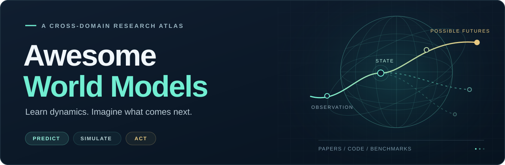

  

  
  
  
  

  <strong>World models across domains — not just autonomous driving.</strong> 
  A curated research atlas spanning interactive games, robotics, medicine, Earth systems and driving, with papers, resources and benchmarks.

  <a href="#explore"><strong>Explore domains</strong></a> &nbsp; · &nbsp;
  <a href="#start-here">Guided reading</a> &nbsp; · &nbsp;
  <a href="#how-to-read-this-list">Scope &amp; labels</a> &nbsp; · &nbsp;
  <a href="#recent-updates">Latest updates</a> &nbsp; · &nbsp;
  <a href="CONTRIBUTING.md">Contribute</a>

Use each entry to compare its **main idea**, **publication status** and **available resources**. Every paper has one primary category, while related predictive representations and simulators are clearly identified.

## Explore

Browse the 11 research collections, or follow a question-led [reading path](#start-here). Driving is one application alongside interactive, embodied, medical and scientific world models.

<!-- NAVIGATION_START -->

<table width="100%">
  <tr>
    <td width="50%" valign="top"><a href="#surveys--perspectives"><strong>Surveys &amp; Perspectives</strong></a> 9 papers · Find a starting point and the bigger picture.</td>
    <td width="50%" valign="top"><a href="#foundations--general-world-models"><strong>Foundations</strong></a> 7 papers · Latent dynamics, imagination and predictive learning.</td>
  </tr>
  <tr>
    <td width="50%" valign="top"><a href="#interactive-worlds--games"><strong>Interactive Worlds &amp; Games</strong></a> 14 papers · Playable environments and controllable generation.</td>
    <td width="50%" valign="top"><a href="#robotics--embodied-world-models"><strong>Robotics &amp; Embodied AI</strong></a> 18 papers · Robot imagination, world-action models and policies.</td>
  </tr>
  <tr>
    <td width="50%" valign="top"><a href="#medical--biological-world-models"><strong>Medicine &amp; Biology</strong></a> 15 papers · Clinical trajectories, cells and molecular dynamics.</td>
    <td width="50%" valign="top"><a href="#social--multi-agent-world-models"><strong>Social &amp; Multi-Agent</strong></a> 5 papers · Agent interactions and social simulation.</td>
  </tr>
  <tr>
    <td width="50%" valign="top"><a href="#physics-weather--scientific-world-models"><strong>Physics &amp; Weather</strong></a> 7 papers · Physical processes, weather and scientific discovery.</td>
    <td width="50%" valign="top"><a href="#remote-sensing--earth-observation"><strong>Remote Sensing &amp; Earth Observation</strong></a> 7 papers · Satellite futures, vegetation and spatial extrapolation.</td>
  </tr>
  <tr>
    <td width="50%" valign="top"><a href="#video--spatial-world-models"><strong>Video &amp; Spatial Worlds</strong></a> 5 papers · Visual prediction, geometry and spatial memory.</td>
    <td width="50%" valign="top"><a href="#general-world-model-benchmarks"><strong>Benchmarks &amp; Evaluation</strong></a> 7 papers · Action fidelity, physical consistency and geometry.</td>
  </tr>
  <tr>
    <td width="50%" valign="top"><a href="#autonomous-driving-world-models"><strong>Autonomous Driving</strong></a> 101 papers · Generation, planning, world-action, JEPA and VLA.</td>
    <td width="50%" valign="top"><a href="#datasets--toolkits"><strong>Datasets &amp; Toolkits</strong></a> Training data, evaluation suites and research systems.</td>
  </tr>
</table>

<!-- NAVIGATION_END -->

## Start here

A short route into each research question. Follow the representative papers, then explore the full collection.

| Research question | Start with | Explore more |
| --- | --- | --- |
| **How do world models learn dynamics?** | [World Models](https://arxiv.org/abs/1803.10122) → [DreamerV3](https://www.nature.com/articles/s41586-025-08744-2) → [V-JEPA 2](https://arxiv.org/abs/2506.09985) | [Foundations](#foundations--general-world-models) |
| **What makes a generated world interactive?** | [Genie](https://arxiv.org/abs/2402.15391) → [DIAMOND](https://arxiv.org/abs/2405.12399) → [GameNGen](https://arxiv.org/abs/2408.14837) | [Interactive worlds](#interactive-worlds--games) |
| **How can prediction guide robot actions?** | [RoboDreamer](https://arxiv.org/abs/2404.12377) → [DreamZero](https://arxiv.org/abs/2602.15922) | [Robotics & embodied AI](#robotics--embodied-world-models) |
| **How do agents model social interactions?** | [Generative Agents](https://arxiv.org/abs/2304.03442) → [Social World Models](https://arxiv.org/abs/2509.00559) → [OASIS](https://arxiv.org/abs/2411.11581) | [Social & multi-agent](#social--multi-agent-world-models) |
| **Can models simulate patient trajectories?** | [PatientWM](https://arxiv.org/abs/2610.17059) → [MedDreamer](https://arxiv.org/abs/2505.19785) → [MeWM](https://arxiv.org/abs/2506.02327) | [Medicine & biology](#medical--biological-world-models) |
| **How do models forecast Earth systems?** | [Aurora](https://www.nature.com/articles/s41586-025-09005-y) → [EO-WM](https://arxiv.org/abs/2606.27277) → [VegSim](https://arxiv.org/abs/2606.21961) | [Earth observation](#remote-sensing--earth-observation) |
| **How should world models be evaluated?** | [WorldSimBench](https://proceedings.mlr.press/v267/qin25f.html) → [WMEval](https://arxiv.org/abs/2610.33894) → [Orbia](https://arxiv.org/abs/2610.20693) | [General benchmarks](#general-world-model-benchmarks) |
| **How do world models support driving?** | [DrivingWorld](https://arxiv.org/abs/2412.19505) → [WorldLens](https://arxiv.org/abs/2512.10958) → [NAVSIM v2](https://arxiv.org/abs/2506.04218) | [Autonomous driving](#autonomous-driving-world-models) |

For the bigger picture, start with [surveys](#surveys--perspectives). For reusable data and research systems, see [Datasets & Toolkits](#datasets--toolkits) and [Industrial & Research Systems](#industrial--research-systems).

## How to read this list

**Scope.** Core world models predict evolving states or the consequences of actions. Predictive representation learning, simulators and related VLA methods appear as clearly identified context, not as equivalent capabilities.

**Resources.** **Code** means implementation; **Repository** means a repository without confirmed implementation availability; **Project** and **Data** are other resource types. Partial or pending releases are marked. **Not verified** means an accessible official implementation was not confirmed. Preprints appear as **arXiv**; verified acceptances are labeled separately.

<strong>Scope: what counts as a world model here?</strong>

| Model type | Included role |
| --- | --- |
| **Predictive / actionable world models** | Predict future dynamics or the consequences of actions, decisions and interventions |
| **World foundation / predictive representation models** | Learn predictive latent representations for perception, planning or scientific analysis |
| **Related simulators / evaluation tools** | Simulated interactions and benchmarks; not necessarily learned causal world models |

Agent simulators and representation learning papers are not automatically considered validated causal world models. See [Definitions & Evaluation](#definitions--evaluation) for interpretation and evaluation considerations.

---

<!-- PAPERS_START -->

## Surveys & Perspectives

**9 papers** · Cross-domain world-model reviews.

| Work | Paper | Focus | Venue | Resources |
| --- | --- | --- | --- | --- |
| **World Model Interpretability** | [World Model Interpretability: From Decoding Representations to Understanding Latent Worlds](https://arxiv.org/abs/2610.25296) | JEPA latent-world grounding and causal verification | arXiv 2026 | [Paper List](https://github.com/Jize-W/Awesome-World-Model-Interpretability) |
| **Embodied WM Survey** | [World Models for Embodied Intelligence: From Plausible to Controllable to Actionable](https://arxiv.org/abs/2609.16697) | From plausible worlds to controllable, actionable models | arXiv 2026 | — |
| **DWM Survey** | [The Role of World Models in Shaping Autonomous Driving: A Comprehensive Survey](https://arxiv.org/abs/2502.10498) | Driving world models by predicted scene modality | [Frontiers of Computer Science 2026 (accepted)](https://journal.hep.com.cn/fcs/EN/10.1007/s11704-026-60102-1) | [Paper List](https://github.com/LMD0311/Awesome-World-Model) |
| **AV JEPA Survey** | [Joint Embedding Predictive Architecture for Autonomous Vehicle Safety and Security: A Comprehensive Survey](https://www.sciencedirect.com/science/article/pii/S1474034626002909) | Survey of JEPA for safer autonomous driving | Advanced Engineering Informatics 2026 | — |
| **Medical World Models Survey** | [Medical world models: representing medical states, modelling clinical dynamics and guiding intervention policies](https://arxiv.org/abs/2606.16721) | Patient dynamics and intervention planning | arXiv 2026 | [Repository](https://github.com/1999kevin/awesome_medical_world_models) |
| **Robotics World Model Survey** | [World Model for Robot Learning: A Comprehensive Survey](https://arxiv.org/abs/2605.00080) | Robot dynamics and policy learning | arXiv 2026 | — |
| **VLA4AD Survey** | [A Survey on Vision-Language-Action Models for Autonomous Driving](https://arxiv.org/abs/2506.24044) | Survey of driving VLA models, data and evaluation | ICCV Workshops 2025 | [Paper List](https://github.com/JohnsonJiang1996/Awesome-VLA4AD) |
| **WMAD Survey** | [A Survey of World Models for Autonomous Driving](https://arxiv.org/abs/2501.11260) | Survey of driving generation and planning models | arXiv 2025 | [Paper List](https://github.com/FengZicai/AwesomeWMAD) |
| **Embodied World Model Survey** | [A Comprehensive Survey on World Models for Embodied AI](https://arxiv.org/abs/2510.16732) | World-model taxonomy across embodied applications | arXiv 2025 | [Repository](https://github.com/Li-Zn-H/AwesomeWorldModels) |

<a href="#explore">↑ Back to collections</a>

## Foundations & General World Models

**7 papers** · Latent dynamics and general predictive world representation learning.

| Model | Paper | Key Idea | Venue | Resources |
| --- | --- | --- | --- | --- |
| **DreamerV3** | [Mastering Diverse Control Tasks Through World Models](https://www.nature.com/articles/s41586-025-08744-2) | General-purpose imagination-based reinforcement learning | Nature 2025 | [Code](https://github.com/danijar/dreamerv3) |
| **V-JEPA 2** | [V-JEPA 2: Self-Supervised Video Models Enable Understanding, Prediction and Planning](https://arxiv.org/abs/2506.09985) | Predictive video features for robot planning | arXiv 2025 | [Code](https://github.com/facebookresearch/vjepa2) |
| **TD-MPC2** | [TD-MPC2: Scalable, Robust World Models for Continuous Control](https://arxiv.org/abs/2310.16828) | Latent dynamics and trajectory optimization | ICLR 2024 | [Code](https://github.com/nicklashansen/tdmpc2) |
| **DreamerV2** | [Mastering Atari with Discrete World Models](https://arxiv.org/abs/2010.02193) | Discrete learned dynamics for Atari control | ICLR 2021 | [Code](https://github.com/danijar/dreamerv2) |
| **Dreamer** | [Dream to Control: Learning Behaviors by Latent Imagination](https://arxiv.org/abs/1912.01603) | Imagined latent trajectories train control policies | ICLR 2020 | [Code](https://github.com/danijar/dreamer) |
| **PlaNet** | [Learning Latent Dynamics for Planning from Pixels](https://arxiv.org/abs/1811.04551) | Pixel-to-latent dynamics for model-based planning | ICML 2019 | [Code](https://github.com/google-research/planet) |
| **World Models (Ha and Schmidhuber)** | [World Models](https://arxiv.org/abs/1803.10122) | Latent world dynamics for imagined agent policies | arXiv 2018 | — |

<a href="#explore">↑ Back to collections</a>

## Interactive Worlds & Games

**14 papers** · Controllable generated interactive environments and playable simulations.

| Model | Paper | Key Idea | Venue | Resources |
| --- | --- | --- | --- | --- |
| **Fight World Model** | [Fight World Model: Customizable Combat through Visual Interaction Proxies](https://arxiv.org/abs/2610.40607) | Combat rules drive controllable visual state transitions | arXiv 2026 | [Repository](https://github.com/fight-world-model/FWM) (code pending) · [Project](https://fight-world-model.github.io/) |
| **Hy-Nomas** | [Hy-Nomas: Towards Free-form Interactive World Generation](https://arxiv.org/abs/2610.36729) | Multi-turn camera and text control of generated worlds | arXiv 2026 | [Code](https://github.com/Tencent-Hunyuan/Hy-Nomas) · [Weights](https://huggingface.co/tencent/Hy-Nomas) |
| **World-in-Context** | [World-in-Context: Interactive Video World Modeling with In-Context Conditioning](https://arxiv.org/abs/2610.33169) | In-context view and action control for interactive video | arXiv 2026 | [Repository](https://github.com/aigc3d/World-in-Context) (code pending) · [Project](https://haroldchen19.github.io/WiC-site/) |
| **WorldCast** | [WorldCast: Distributed Multiplayer World Models](https://arxiv.org/abs/2610.12412) | Shared states keep multiplayer worlds consistent | arXiv 2026 | [Code](https://github.com/Ziyang-Ye/WorldCast) · [Project](https://ziyang-ye.github.io/WorldCast-Page/) |
| **Spatial Memory Intelligence** | [Spatial Memory Intelligence: Endowing World Models with Understanding-Driven Long-Term Memory](https://arxiv.org/abs/2610.02521) | Action-aware spatial memory for persistent worlds | arXiv 2026 | [Repository](https://github.com/xbyym/Spatial-Memory-Intelligence) (code pending) · [Project](https://spatial-memory-intelligence.github.io/) |
| **SolarWM** | [SolarWM: Open Data and Scalable Training for Long-Horizon Video World Models](https://arxiv.org/abs/2609.02886) | Scalable interactive-world training from 1.43M clips | arXiv 2026 | [Code](https://github.com/Junchao-cs/SolarWM) · [Project](https://junchao-cs.github.io/SolarWM-Web/) · [Data](https://huggingface.co/datasets/junchaoh-cs/SolarWM-Data) |
| **LIVE** | [LIVE: Long-horizon Interactive Video World Modeling](https://arxiv.org/abs/2602.03747) | Forward–reverse cycles stabilize long video rollouts | ICML 2026 | [Code](https://github.com/Junchao-cs/LIVE) (partial) · [Project](https://junchao-cs.github.io/LIVE-demo/) |
| **Memory Forcing** | [Memory Forcing: Spatio-Temporal Memory for Consistent Scene Generation on Minecraft](https://arxiv.org/abs/2510.03198) | Scene memory stabilizes revisited Minecraft views | NeurIPS 2026 | [Repository](https://github.com/Junchao-cs/Memory-Forcing) (code pending) · [Project](https://junchao-cs.github.io/MemoryForcing/) |
| **Dreamer 4** | [Training Agents Inside of Scalable World Models](https://arxiv.org/abs/2509.24527) | Minecraft world simulation trains agents by imagination | arXiv 2025 | [Project](https://danijar.com/project/dreamer4/) |
| **GameNGen** | [Diffusion Models Are Real-Time Game Engines](https://arxiv.org/abs/2408.14837) | Action-conditioned diffusion game engine | ICLR 2025 | — |
| **GameFactory** | [GameFactory: Creating New Games with Generative Interactive Videos](https://arxiv.org/abs/2501.08325) | Action-controlled video games with scene generalization | ICCV 2025 | [Code](https://github.com/KlingAIResearch/GameFactory) (partial) |
| **Matrix-Game 2.0** | [Matrix-Game 2.0: An Open-Source, Real-Time, and Streaming Interactive World Model](https://arxiv.org/abs/2508.13009) | Real-time neural games steered by player actions | arXiv 2025 | [Code](https://github.com/SkyworkAI/Matrix-Game) |
| **Genie** | [Genie: Generative Interactive Environments](https://arxiv.org/abs/2402.15391) | Learned latent actions for playable generated worlds | arXiv 2024 | — |
| **DIAMOND** | [Diffusion for World Modeling: Visual Details Matter in Atari](https://arxiv.org/abs/2405.12399) | Diffusion dynamics for Atari control and game rollouts | NeurIPS 2024 | [Code](https://github.com/eloialonso/diamond) |

<a href="#explore">↑ Back to collections</a>

## Robotics & Embodied World Models

**18 papers** · Robot-action-conditioned video, imagined state and model-based policies.

| Model | Paper | Key Idea | Venue | Resources |
| --- | --- | --- | --- | --- |
| **CausalWAM** | [CausalWAM: Learning the Causes of Actions in World Action Models](https://arxiv.org/abs/2610.42096) | Causal latent routing isolates action-driving factors | arXiv 2026 | — |
| **AW-0** | [Agentic World Action Models](https://arxiv.org/abs/2610.30136) | Co-generates code skills, video and robot actions | arXiv 2026 | [Code](https://github.com/ZhuoyangLiu2005/agentic-wam) · [Project](https://agentic-wam.github.io/) · [Weights](https://huggingface.co/miniFranka/agentic-wam-pretrain-yamego3k-soup-e1) |
| **T2-z** | [T2-z: Test-Time Optimization of Environment Latents for Robotic World Models](https://arxiv.org/abs/2610.22364) | Test-time latent adaptation to unseen robot physics | arXiv 2026 | [Code](https://github.com/T2-z-latent-optimization/T2-z) · [Project](https://t2-z-latent-optimization.github.io/) · [Data](https://huggingface.co/datasets/huagailuowen/T2-z-datasets) |
| **Long-WAM** | [Long-WAM: Scaling the Context of World-Action Models](https://arxiv.org/abs/2610.10528) | Long-context video pretraining for robot control | arXiv 2026 | [Code](https://github.com/NVlabs/LongLive/tree/main/Long-WAM) · [Project](https://nvlabs.github.io/LongLive/Long-WAM/) |
| **OpenWAM (Stanford)** | [OpenWAM: An Open Framework for Composable World-Action Models](https://arxiv.org/abs/2610.07922) | Composable video-action models and inverse dynamics | arXiv 2026 | [Code](https://github.com/OpenWAM/OpenWAM) (partial) · [Project](https://openwam.stanford.edu/) |
| **EVO-WAM** | [EVO-WAM: Evolving World Action Models through Video-Action Verification](https://arxiv.org/abs/2609.38057) | Verified imagined rollouts improve robot policies | arXiv 2026 | [Repository](https://github.com/Clausy9/EVO-WAM) · [Project](https://evo-wam.github.io/) |
| **XPACE** | [XPACE: Joint World and Action Modeling from Heterogeneous Experience](https://arxiv.org/abs/2609.17372) | Shared video backbone predicts robot actions and futures | arXiv 2026 | [Project](https://xpeng-robotics.github.io/xpace/) |
| **SyncWorld** | [SyncWorld: Visual Calibration Enables World Models as Zero-Shot Simulators](https://arxiv.org/abs/2609.09155) | Action–video calibration for robot simulation transfer | NeurIPS 2026 (accepted) | [Code](https://github.com/UMass-Embodied-AGI/SyncWorld) · [Project](https://umass-embodied-agi.github.io/SyncWorld/) · [Weights](https://huggingface.co/yyuncong/SyncWorld) |
| **Fast-WAM** | [Fast-WAM: Do World Action Models Need Test-time Future Imagination?](https://arxiv.org/abs/2603.16666) | Video co-training without rollout at inference | arXiv 2026 | [Code](https://github.com/yuantianyuan01/FastWAM) · [Project](https://yuantianyuan01.github.io/FastWAM/) |
| **DreamZero** | [World Action Models are Zero-shot Policies](https://arxiv.org/abs/2602.15922) | Video-action diffusion for zero-shot robot control | arXiv 2026 | [Code](https://github.com/dreamzero0/dreamzero) · [Project](https://dreamzero0.github.io/) |
| **DreamDojo** | [DreamDojo: A Generalist Robot World Model from Large-Scale Human Videos](https://proceedings.mlr.press/v306/gao26q.html) | Robot dynamics from action-conditioned human video | ICML 2026 | [Code](https://github.com/NVIDIA/DreamDojo) |
| **DreamGen** | [DreamGen: Unlocking Generalization in Robot Learning through Neural Trajectories](https://arxiv.org/abs/2505.12705) | Synthetic world trajectories for robot policies | arXiv 2025 | — |
| **WorldVLA** | [WorldVLA: Towards Autoregressive Action World Model](https://arxiv.org/abs/2506.21539) | Shared autoregressive world and action model | arXiv 2025 | — |
| **SurgWorld** | [SurgWorld: Learning Surgical Robot Policies from Videos via World Modeling](https://arxiv.org/abs/2512.23162) | Surgical world dynamics for robot imitation | arXiv 2025 | — |
| **RoboDreamer** | [RoboDreamer: Learning Compositional World Models for Robot Imagination](https://arxiv.org/abs/2404.12377) | Compositional robot world prediction | ICML 2024 | [Code](https://github.com/UMass-Embodied-AGI/robodreamer) |
| **IRASim** | [IRASim: Learning Interactive Real-Robot Action Simulators](https://arxiv.org/abs/2406.14540) | Action-conditioned robot video simulation | arXiv 2024 | [Code](https://github.com/bytedance/IRASim) |
| **GR-2** | [GR-2: A Generative Video-Language-Action Model with Web-Scale Knowledge for Robot Manipulation](https://arxiv.org/abs/2410.06158) | Joint robot action and future video modeling | arXiv 2024 | — |
| **UniPi** | [Learning Universal Policies via Text-Guided Video Generation](https://arxiv.org/abs/2302.00111) | Text-guided imagined plans translated into actions | NeurIPS 2023 | — |

<a href="#explore">↑ Back to collections</a>

## Medical & Biological World Models

**15 papers** · Patient, cell and molecular dynamics, with related biomedical predictive representation models.

| Model | Paper | Key Idea | Venue | Resources |
| --- | --- | --- | --- | --- |
| **PatientWM** | [PatientWM: Towards Generalizable Clinical World Models via Unified Patient States](https://arxiv.org/abs/2610.17059) | Action-conditioned patient states for clinical forecasts | arXiv 2026 | — |
| **JEPA-DNA** | [JEPA-DNA: Grounding Genomic Foundation Models through Joint-Embedding Predictive Architectures](https://arxiv.org/abs/2602.17162) | Masked genomic prediction with generative objectives | arXiv 2026 | [Code](https://github.com/NVIDIA-BioNeMo/JEPA-DNA) · [Weights](https://huggingface.co/collections/nvidia/jepa-dna) |
| **Cell-JEPA** | [Cell-JEPA: Latent Representation Learning for Single-Cell Transcriptomics](https://arxiv.org/abs/2602.02093) | Predicts cell embeddings from partial gene expression | arXiv 2026 | — |
| **MedDreamer** | [MedDreamer: Model-Based Reinforcement Learning with Latent Imagination on Complex EHRs for Clinical Decision Support](https://arxiv.org/abs/2505.19785) | Clinical decisions from imagined patient trajectories | KDD 2026 | [Code](https://github.com/xuqianyi/medDreamer) |
| **EHRWorld** | [EHRWorld: A Patient-Centric Medical World Model for Long-Horizon Clinical Trajectories](https://arxiv.org/abs/2602.03569) | Predicts longitudinal patient states and outcomes | arXiv 2026 | — |
| **Brain-WM** | [Brain-WM: Brain Glioblastoma World Model](https://arxiv.org/abs/2603.07562) | Brain tumor evolution and disease progression | arXiv 2026 | — |
| **EchoJEPA** | [EchoJEPA: A Latent Predictive Foundation Model for Echocardiography](https://arxiv.org/abs/2602.02603) | Predictive ultrasound features, not interventions | arXiv 2026 | [Code](https://github.com/bowang-lab/EchoJEPA) |
| **X-WIN** | [X-WIN: Building Chest Radiograph World Model via Predictive Sensing](https://arxiv.org/abs/2511.14918) | Predictive chest X-ray volumetric representations | CVPR 2026 | — |
| **HounsWorld** | [HounsWorld: A Multimodal World Model for Hidden Patient-State Readout, Reconstruction, and Simulation](https://arxiv.org/abs/2608.12904) | CT and clinical text hidden patient-state simulation | arXiv 2026 | — |
| **UltraWorld** | [UltraWorld: Learning Interactive Ultrasound World Models from Untracked Clinical Videos with Acoustic Sampling Map](https://arxiv.org/abs/2610.09785) | Probe-conditioned interactive ultrasound dynamics | arXiv 2026 | — |
| **Lingshu-Cell** | [Lingshu-Cell: A Generative Cellular World Model for Transcriptome Modeling toward Virtual Cells](https://arxiv.org/abs/2603.25240) | Cellular transcriptome responses to interventions | arXiv 2026 | — |
| **MeWM** | [Medical World Model: Generative Simulation of Tumor Evolution for Treatment Planning](https://arxiv.org/abs/2506.02327) | Treatment-conditioned tumor evolution for planning | ICCV 2025 | [Code](https://github.com/scott-yjyang/MeWM) |
| **CheXWorld** | [CheXWorld: Exploring Image World Modeling for Radiograph Representation Learning](https://arxiv.org/abs/2504.13820) | Predictive radiograph representation learning | CVPR 2025 | [Code](https://github.com/LeapLabTHU/CheXWorld) |
| **MDGen** | [Generative Modeling of Molecular Dynamics Trajectories](https://arxiv.org/abs/2409.17808) | Generates molecular trajectories for simulation | [NeurIPS 2024](https://proceedings.neurips.cc/paper_files/paper/2024/hash/478b06f60662d3cdc1d4f15d4587173a-Abstract-Conference.html) | [Code](https://github.com/bjing2016/mdgen) · [Weights](https://huggingface.co/bjing-mit/mdgen) · [Data](https://huggingface.co/datasets/bjing-mit/tetrapeptide-sims) |
| **Brain-JEPA** | [Brain-JEPA: Brain Dynamics Foundation Model with Gradient Positioning and Spatiotemporal Masking](https://arxiv.org/abs/2409.19407) | Spatiotemporal fMRI predictive representation model | NeurIPS 2024 | [Code](https://github.com/Eric-LRL/Brain-JEPA) |

<a href="#explore">↑ Back to collections</a>

## Social & Multi-Agent World Models

**5 papers** · Social-state transitions and related agent simulation systems.

| Model | Paper | Key Idea | Venue | Resources |
| --- | --- | --- | --- | --- |
| **Social World Models** | [Social World Models](https://arxiv.org/abs/2509.00559) | Predicts interpersonal actions and hidden social states | arXiv 2025 | — |
| **SOTOPIA** | [SOTOPIA: Interactive Evaluation for Social Intelligence in Language Agents](https://proceedings.iclr.cc/paper_files/paper/2024/hash/b3075b88e583a0e98d8b24338a613060-Abstract-Conference.html) | Interactive agent social evaluation environment | ICLR 2024 | [Code](https://github.com/sotopia-lab/sotopia) |
| **OASIS** | [OASIS: Open Agent Social Interaction Simulations with One Million Agents](https://arxiv.org/abs/2411.11581) | Evolving social-network multi-agent simulations | arXiv 2024 | — |
| **Generative Agents** | [Generative Agents: Interactive Simulacra of Human Behavior](https://arxiv.org/abs/2304.03442) | Memory-based multi-agent social simulator | UIST 2023 | [Code](https://github.com/joonspk-research/generative_agents) |
| **Concordia** | [Generative agent-based modeling with actions grounded in physical, social, or digital space using Concordia](https://arxiv.org/abs/2312.03664) | Environment-grounded generative social agents | arXiv 2023 | [Code](https://github.com/google-deepmind/concordia) |

<a href="#explore">↑ Back to collections</a>

## Physics, Weather & Scientific World Models

**7 papers** · Physical and Earth-system dynamics, with related scientific predictive representation models.

| Model | Paper | Key Idea | Venue | Resources |
| --- | --- | --- | --- | --- |
| **Aurora** | [A foundation model for the Earth system](https://www.nature.com/articles/s41586-025-09005-y) | Earth-system forecasting across weather and oceans | Nature 2025 | [Code](https://github.com/microsoft/aurora) · [Project](https://microsoft.github.io/aurora/) · [Weights](https://huggingface.co/microsoft/aurora) |
| **NeuralGCM** | [Neural general circulation models for weather and climate](https://www.nature.com/articles/s41586-024-07744-y) | Differentiable climate and atmosphere dynamic simulation | Nature 2024 | [Code](https://github.com/google-research/neuralgcm) |
| **GenCast** | [Probabilistic weather forecasting with machine learning](https://www.nature.com/articles/s41586-024-08252-9) | Probabilistic atmospheric forecasts | Nature 2024 | — |
| **GraphCast** | [Learning skillful medium-range global weather forecasting](https://www.science.org/doi/10.1126/science.adi2336) | Graph neural forecasting of weather dynamics | Science 2023 | [Code](https://github.com/google-deepmind/graphcast) |
| **FourCastNet** | [FourCastNet: A Global Data-driven High-resolution Weather Model using Adaptive Fourier Neural Operators](https://arxiv.org/abs/2202.11214) | Global atmospheric forecasting with Fourier operators | arXiv 2022 | [Code](https://github.com/NVlabs/FourCastNet) |
| **MeshGraphNets** | [Learning Mesh-Based Simulation with Graph Networks](https://arxiv.org/abs/2010.03409) | Fluid and mesh state transitions | ICLR 2021 | — |
| **Graph Physics Simulator** | [Learning to Simulate Complex Physics with Graph Networks](https://arxiv.org/abs/2002.09405) | Graph-based dynamics for interacting particles | ICML 2020 | — |

<a href="#explore">↑ Back to collections</a>

## Remote Sensing & Earth Observation

Forecasting, directional spatial extrapolation and related predictive representations for Earth observation. Resource status is based on verification on 2026-11-03: Not verified means no accessible official implementation was confirmed; the RS-WorldModel repository linked in its paper returned 404.

[Future Forecasting & Scenario Simulation](#eo-future-forecasting--scenario-simulation) · [Spatial Extrapolation](#eo-spatial-extrapolation) · [Predictive Representations (Related)](#eo-predictive-representations-related)

### EO: Future Forecasting & Scenario Simulation

**4 papers** · Future multispectral scenes, vegetation states and cloud-dependent observability, conditioned on weather or language.

| Model | Paper | Key Idea | Venue | Resources |
| --- | --- | --- | --- | --- |
| **Cloud-aware LeWorldModel** | [From Surface Forecasting to Observability Forecasting: A Latent World Model for Cloud-Aware EO Monitoring](https://arxiv.org/abs/2607.13651) | Latent forecasts of cloud-free observation windows | arXiv 2026 | Not verified |
| **EO-WM** | [EO-WM: A Physically Informed World Model for Probabilistic Earth Observation Forecasting](https://arxiv.org/abs/2606.27277) | Weather-conditioned multispectral future forecasting | NeurIPS 2026 (accepted) | [Code](https://github.com/hku-sail/EO-WM) |
| **VegSim** | [VegSim: A Geospatial World Model for Scenario-Conditioned Vegetation Simulation](https://arxiv.org/abs/2606.21961) | Scenario-conditioned vegetation dynamics and NDVI | ACM SIGSPATIAL (Application Short) 2026 (accepted) | [Code](https://github.com/arco-group/vegsim) |
| **RS-WorldModel** | [RS-WorldModel: a Unified Model for Remote Sensing Understanding and Future Sense Forecasting](https://arxiv.org/abs/2603.14941) | Geo-conditioned future scenes and change understanding | arXiv 2026 | Not verified |

<a href="#explore">↑ Back to collections</a>

### EO: Spatial Extrapolation

**1 paper** · Directional continuation into unobserved neighboring image tiles; spatial rather than temporal transitions.

| Model | Paper | Key Idea | Venue | Resources |
| --- | --- | --- | --- | --- |
| **RemoteBAGEL / RSWISE** | [Remote Sensing-Oriented World Model](https://arxiv.org/abs/2509.17808) | Directional adjacent-tile generation for spatial worlds | arXiv 2025 | Not verified |

<a href="#explore">↑ Back to collections</a>

### EO: Predictive Representations (Related)

**2 papers** · Related JEPA and multimodal generative representations for downstream perception, without explicit future-state simulation.

| Model | Paper | Key Idea | Venue | Resources |
| --- | --- | --- | --- | --- |
| **FusDreamer** | [FusDreamer: Label-Efficient Remote Sensing World Model for Multimodal Data Classification](https://doi.org/10.1109/TGRS.2025.3554862) | Diffusion fusion of HSI, LiDAR and text | IEEE TGRS 2025 | [Code](https://github.com/Cimy-wang/FusDreamer) |
| **AnySat** | [AnySat: One Earth Observation Model for Many Resolutions, Scales, and Modalities](https://openaccess.thecvf.com/content/CVPR2025/html/Astruc_AnySat_One_Earth_Observation_Model_for_Many_Resolutions_Scales_and_CVPR_2025_paper.html) | Scale-adaptive JEPA across heterogeneous EO sensors | CVPR 2025 | [Code](https://github.com/gastruc/AnySat) · [Project](https://gastruc.github.io/anysat) |

<a href="#explore">↑ Back to collections</a>

## Video & Spatial World Models

**5 papers** · Predictive and controllable representations of visual worlds.

| Model | Paper | Key Idea | Venue | Resources |
| --- | --- | --- | --- | --- |
| **Mask Forcing** | [Mask Forcing: Improving Autoregressive Video Diffusion Distillation via Dual-Noise Masking Rollout](https://arxiv.org/abs/2609.09123) | Dual-noise masking stabilizes video distillation | arXiv 2026 | [Code](https://github.com/delaprada/Mask-Forcing) · [Project](https://alicezrzhao.github.io/mask_forcing/) |
| **VideoRAE** | [VideoRAE: Taming Video Foundation Models for Generative Modeling via Representation Autoencoders](https://arxiv.org/abs/2607.14088) | Compact foundation-video latents for generation | arXiv 2026 | [Code](https://github.com/zhxie0117/VideoRAE) · [Project](https://zhxie0117.github.io/VideoRAE/) |
| **Holo-World** | [Holo-World: Unified Camera, Object and Weather Control for Video World Model](https://arxiv.org/abs/2606.20083) | Joint camera, object and weather control from one image | arXiv 2026 | [Repository](https://github.com/XiangchenYin/Holo-World) · [Project](https://xiangchenyin.github.io/Holo-World/) |
| **SymphoMotion** | [SymphoMotion: Joint Control of Camera Motion and Object Dynamics for Coherent Video Generation](https://arxiv.org/abs/2604.03723) | Joint camera and object motion for coherent video | CVPR 2026 | [Code](https://github.com/grenoble-zhang/SymphoMotion) · [Project](https://grenoble-zhang.github.io/SymphoMotion/) |
| **V-JEPA** | [Revisiting Feature Prediction for Learning Visual Representations from Video](https://arxiv.org/abs/2404.08471) | Predictive video representations for world modeling | arXiv 2024 | — |

<a href="#explore">↑ Back to collections</a>

## General World-Model Benchmarks

**7 papers** · Evaluation across action fidelity, physical consistency and geometry.

| Benchmark | Paper | Evaluation Focus | Venue | Resources |
| --- | --- | --- | --- | --- |
| **GameVerse** | [GameVerse: A Minute-Scale Gameplay Dataset for Long-Horizon Interactive World Modeling](https://arxiv.org/abs/2610.37257) | Minute-scale gameplay data for long-horizon worlds | NeurIPS 2026 (accepted) | [Data](https://huggingface.co/datasets/Kangverse/GameVerse) · [Project](https://kangverse.github.io/GameVerse/) · [Code](https://github.com/kangverse/GameVerse/tree/main/data_tools) |
| **WMEval** | [WMEval: Evaluating Interactive World Models Grounded on Physical Simulations](https://arxiv.org/abs/2610.33894) | Tests physical causality and action fidelity in Unity | arXiv 2026 | [Code](https://github.com/hao-ai-lab/WMEval) · [Project](https://snyhlx.github.io/wmeval-blog/) · [Data](https://huggingface.co/datasets/lmgame/WMEval-Lite) |
| **AnyGoal** | [AnyGoal: On World Model Generalization Beyond Expert Rollouts](https://arxiv.org/abs/2610.26844) | Tests planning beyond expert-rollout distributions | arXiv 2026 | [Code](https://github.com/galilai-group/AnyGoal) · [Project](https://hazel-heejeong-nam.github.io/anygoal/) |
| **Orbia** | [Orbia: Do Generated Videos Form a Consistent 3D World?](https://arxiv.org/abs/2610.20693) | Revisit tests for persistent 3D video worlds | arXiv 2026 | [Code](https://github.com/worldbench/Orbia) · [Project](https://orbia-bench.github.io/) · [Data](https://huggingface.co/datasets/Orbia/Orbia) |
| **4DWorldBench** | [4DWorldBench: A Comprehensive Evaluation Framework for 3D/4D World Generation Models](https://openaccess.thecvf.com/content/CVPR2026/html/Lu_4DWorldBench_A_Comprehensive_Evaluation_Framework_for_3D4D_World_Generation_Models_CVPR_2026_paper.html) | Evaluates geometric and temporal world generation | CVPR 2026 | — |
| **WorldSimBench** | [WorldSimBench: Towards Video Generation Models as World Simulators](https://proceedings.mlr.press/v267/qin25f.html) | Evaluates interactive fidelity of world simulators | ICML 2025 | — |
| **PhysBench** | [PhysBench: Benchmarking and Enhancing Vision-Language Models for Physical World Understanding](https://arxiv.org/abs/2501.16411) | Tests physical understanding, related benchmark | ICLR 2025 | — |

<a href="#explore">↑ Back to collections</a>

## Autonomous Driving World Models

Autonomous driving is one application of world models, including generation, latent prediction, world-action, JEPA, VLA and benchmarks.

[Generative & Explicit-State Models](#driving-generative--explicit-state-models) · [Latent & Planning-Oriented Models](#driving-latent--planning-oriented-models) · [World-Action & Action-Aligned Models](#driving-world-action--action-aligned-models) · [JEPA & Predictive Representations](#driving-jepa--predictive-representations) · [World-Model-Enhanced VLA](#driving-world-model-enhanced-vla) · [Selected General VLA (Context)](#driving-selected-general-vla-context) · [Benchmarks & Simulation](#driving-benchmarks--simulation)

### Driving: Generative & Explicit-State Models

**27 papers** · RGB, LiDAR, occupancy and future-geometry driving worlds.

| Model | Paper | Key Idea | Venue | Resources |
| --- | --- | --- | --- | --- |
| **InfraWorld** | [InfraWorld: Motion-Aware World Modeling for Roadside 4D Occupancy Forecasting](https://arxiv.org/abs/2610.14544) | Roadside BEV futures with persistent motion queries | arXiv 2026 | — |
| **GeoWM** | [GeoWM: Efficient Direct World Modeling in Explicit Geometry](https://arxiv.org/abs/2610.07381) | Flow matching predicts future 3D geometry by horizon | arXiv 2026 | — |
| **CoDrive** | [CoDrive: Cross-Vehicle World-Consistent Video Generation with Precise Trajectory Control for Cooperative Driving](https://arxiv.org/abs/2609.34749) | Shared coordinates align multi-vehicle video futures | arXiv 2026 | — |
| **ZYT-World** | [ZYT-World: A Real-Time Controllable World Model for Closed-Loop Autonomous-Driving Simulation](https://arxiv.org/abs/2609.21712) | Streaming fisheye/pinhole video with action control | arXiv 2026 | [Project](https://zyt-aim.github.io/ZYT-World/) |
| **CausalDrive** | [CausalDrive: Real-time Causal World Models for Autonomous Driving](https://arxiv.org/abs/2606.15341) | Text/ego-conditioned reactive future video generation | arXiv 2026 | — |
| **HelloWorld** | [HelloWorld: Towards Practical Applications of Generative Driving World Models](https://arxiv.org/abs/2609.28931) | Controllable multi-camera RGB and LiDAR generation | arXiv 2026 | [Project](https://helloworld-4d.github.io/) |
| **Epona** | [Epona: Autoregressive Diffusion World Model for Autonomous Driving](https://arxiv.org/abs/2506.24113) | Autoregressive diffusion for long driving rollouts | ICCV 2025 | [Code](https://github.com/Kevin-thu/Epona) |
| **ReSim** | [ReSim: Reliable World Simulation for Autonomous Driving](https://arxiv.org/abs/2506.09981) | Action-faithful driving simulation from varied data | [NeurIPS 2025](https://proceedings.neurips.cc/paper_files/paper/2025/hash/f502981cbe221d857ad409450a7917c3-Abstract-Conference.html) | [Code](https://github.com/OpenDriveLab/ReSim) · [Project](https://opendrivelab.com/ReSim) |
| **GAIA-2** | [GAIA-2: A Controllable Multi-View Generative World Model for Autonomous Driving](https://arxiv.org/abs/2503.20523) | Latent diffusion controls agents and camera dynamics | arXiv 2025 | [Project](https://wayve.ai/thinking/gaia-2/) |
| **MaskGWM** | [MaskGWM: A Generalizable Driving World Model with Video Mask Reconstruction](https://arxiv.org/abs/2502.11663) | Masked video diffusion improves driving prediction | [CVPR 2025](https://openaccess.thecvf.com/content/CVPR2025/html/Ni_MaskGWM_A_Generalizable_Driving_World_Model_with_Video_Mask_Reconstruction_CVPR_2025_paper.html) | [Code](https://github.com/SenseTime-FVG/OpenDWM) |
| **HERMES** | [HERMES: A Unified Self-Driving World Model for Simultaneous 3D Scene Understanding and Generation](https://arxiv.org/abs/2501.14729) | BEV-based scene understanding and future generation | ICCV 2025 | [Code](https://github.com/LMD0311/HERMES) |
| **InfiniCube** | [InfiniCube: Unbounded and Controllable Dynamic 3D Driving Scene Generation with World-Guided Video Models](https://arxiv.org/abs/2412.03934) | Controllable 3D worlds grounded by video models | ICCV 2025 | [Code](https://github.com/nv-tlabs/InfiniCube) |
| **LidarDM** | [LidarDM: Generative LiDAR Simulation in a Generated World](https://arxiv.org/abs/2404.02903) | 4D LiDAR generation with physical sensor simulation | ICRA 2025 | [Code](https://github.com/vzyrianov/LidarDM) · [Project](https://zyrianov.org/lidardm/) |
| **DriveDreamer-2** | [DriveDreamer-2: LLM-Enhanced World Models for Diverse Driving Video Generation](https://arxiv.org/abs/2403.06845) | LLM-conditioned customized multi-view driving generation | AAAI 2025 | [Code](https://github.com/f1yfisher/DriveDreamer2) · [Project](https://drivedreamer2.github.io/) |
| **MUVO** | [MUVO: A Multimodal Generative World Model for Autonomous Driving with Geometric Representations](https://arxiv.org/abs/2311.11762) | Camera–LiDAR dynamics in geometric latent states | IEEE IV 2025 | [Code](https://github.com/daniel-bogdoll/MUVO) |
| **DrivingWorld** | [DrivingWorld: Constructing World Model for Autonomous Driving via Video GPT](https://arxiv.org/abs/2412.19505) | GPT-style autoregressive video and ego-state generation | arXiv 2024 | [Code](https://github.com/YvanYin/DrivingWorld) (partial) |
| **DOME** | [DOME: Taming Diffusion Model into High-Fidelity Controllable Occupancy World Model](https://arxiv.org/abs/2410.10429) | Trajectory-conditioned diffusion of 3D occupancy | arXiv 2024 | [Code](https://github.com/gusongen/DOME) · [Project](https://gusongen.github.io/DOME/) |
| **Vista** | [Vista: A Generalizable Driving World Model with High Fidelity and Versatile Controllability](https://arxiv.org/abs/2405.17398) | Controllable driving rollouts with visual reward signals | NeurIPS 2024 | [Code](https://github.com/OpenDriveLab/Vista) · [Project](https://vista-demo.github.io/) |
| **GenAD** | [GenAD: Generalized Predictive Model for Autonomous Driving](https://arxiv.org/abs/2403.09630) | Large-scale action-conditioned driving video prediction | CVPR 2024 | [Data](https://github.com/OpenDriveLab/DriveAGI) |
| **WoVoGen** | [WoVoGen: World Volume-aware Diffusion for Controllable Multi-camera Driving Scene Generation](https://arxiv.org/abs/2312.02934) | 4D world volumes for multi-camera diffusion | ECCV 2024 | [Code](https://github.com/fudan-zvg/WoVoGen) |
| **Drive-WM** | [Driving into the Future: Multiview Visual Forecasting and Planning with World Model for Autonomous Driving](https://arxiv.org/abs/2311.17918) | Multi-view future video supports trajectory planning | CVPR 2024 | [Code](https://github.com/BraveGroup/Drive-WM) |
| **Panacea** | [Panacea: Panoramic and Controllable Video Generation for Autonomous Driving](https://arxiv.org/abs/2311.16813) | Cross-view consistent panoramic driving video | CVPR 2024 | [Code](https://github.com/wenyuqing/panacea) · [Project](https://panacea-ad.github.io/) |
| **OccWorld** | [OccWorld: Learning a 3D Occupancy World Model for Autonomous Driving](https://arxiv.org/abs/2311.16038) | Joint future 3D occupancy and ego-motion prediction | ECCV 2024 | [Code](https://github.com/wzzheng/OccWorld) |
| **Copilot4D** | [Copilot4D: Learning Unsupervised World Models for Autonomous Driving via Discrete Diffusion](https://arxiv.org/abs/2311.01017) | Tokenized sensor world modeling with discrete diffusion | ICLR 2024 | — |
| **DriveDreamer** | [DriveDreamer: Towards Real-world-driven World Models for Autonomous Driving](https://arxiv.org/abs/2309.09777) | Traffic-controlled real-world diffusion simulation | ECCV 2024 | [Code](https://github.com/JeffWang987/DriveDreamer) · [Project](https://drivedreamer.github.io/) |
| **ADriver-I** | [ADriver-I: A General World Model for Autonomous Driving](https://arxiv.org/abs/2311.13549) | Interleaved vision–action modeling with diffusion | arXiv 2023 | — |
| **GAIA-1** | [GAIA-1: A Generative World Model for Autonomous Driving](https://arxiv.org/abs/2309.17080) | Joint video, text and action token prediction | arXiv 2023 | [Blog](https://wayve.ai/thinking/scaling-gaia-1/) |

<a href="#explore">↑ Back to collections</a>

### Driving: Latent & Planning-Oriented Models

**20 papers** · Future latent states and world-model-based driving plans.

| Model | Paper | Key Idea | Venue | Resources |
| --- | --- | --- | --- | --- |
| **DPR** | [Directional Pullback Regularization for Long-Horizon Rollout of Latent World Models in Autonomous Driving](https://arxiv.org/abs/2610.16139) | Kinematic latent regularization stabilizes long rollouts | arXiv 2026 | — |
| **RoXDrive** | [RoXDrive: Closed-Loop Reinforcement Learning for End-to-End Autonomous Driving via Action-Faithful Rollouts](https://arxiv.org/abs/2609.36851) | RL filters action-faithful world-model rollouts | arXiv 2026 | [Repository](https://github.com/Hongbin98/RoXDrive) · [Project](https://hongbin98.github.io/RoXDrive/) |
| **MomWorld** | [MomWorld: Momentum-Aware Latent World Model for Long-Horizon Autonomous Driving](https://arxiv.org/abs/2609.33737) | Latent momentum and resets stabilize long rollouts | arXiv 2026 | — |
| **ReDrive** | [ReDrive: Shaping Representations with World Modeling for End-to-End Driving](https://arxiv.org/abs/2609.33854) | Future features improve plans without online rollouts | arXiv 2026 | — |
| **Relationally Grounded LWM** | [Relationally Grounded Latent World Models for Autonomous Driving](https://arxiv.org/abs/2609.24626) | Traffic-graph semantics supervise latent world states | IROS RoBoWoMo Workshop 2026 | — |
| **GraphWorld** | [GraphWorld: Long-Horizon Planning with World Models for End-to-End Autonomous Driving](https://arxiv.org/abs/2606.16274) | Traffic-graph latent states for long-horizon planning | arXiv 2026 | — |
| **DeepSight** | [DeepSight: Long-Horizon World Modeling via Latent States Prediction for End-to-End Autonomous Driving](https://arxiv.org/abs/2605.10564) | Parallel long-horizon BEV latent-state prediction | [ICML 2026](https://proceedings.mlr.press/v306/zhang26gq.html) | [Code](https://github.com/hotdogcheesewhite/DeepSight) |
| **DriveFuture** | [DriveFuture: Future-Aware Latent World Models for Autonomous Driving](https://arxiv.org/abs/2605.09701) | Future latents condition trajectory diffusion planning | arXiv 2026 | — |
| **WorldDrive** | [Bridging Scene Generation and Planning: Driving with World Model via Unifying Vision and Motion Representation](https://arxiv.org/abs/2603.14948) | Vision-motion pretraining transfers to driving plans | [NeurIPS 2026 (accepted)](https://github.com/TabGuigui/WorldDrive) | [Code](https://github.com/TabGuigui/WorldDrive) |
| **DriveLaW** | [DriveLaW: Unifying Planning and Video Generation in a Latent Driving World](https://arxiv.org/abs/2512.23421) | World latents injected into a diffusion planner | CVPR 2026 | [Code](https://github.com/xiaomi-research/drivelaw) |
| **World4Drive** | [World4Drive: End-to-End Autonomous Driving via Intention-aware Physical Latent World Model](https://arxiv.org/abs/2507.00603) | Intention-aware futures for trajectory selection | ICCV 2025 | [Code](https://github.com/ucaszyp/World4Drive) |
| **Raw2Drive** | [Raw2Drive: Reinforcement Learning with Aligned World Models for End-to-End Autonomous Driving (in CARLA v2)](https://arxiv.org/abs/2505.16394) | Aligns privileged and raw-sensor world models for RL | NeurIPS 2025 | [Repository](https://github.com/Thinklab-SJTU/Raw2Drive) |
| **WoTE** | [End-to-End Driving with Online Trajectory Evaluation via BEV World Model](https://arxiv.org/abs/2504.01941) | Future BEV states score candidate driving paths | [ICCV 2025](https://openaccess.thecvf.com/content/ICCV2025/html/Li_End-to-End_Driving_with_Online_Trajectory_Evaluation_via_BEV_World_Model_ICCV_2025_paper.html) | [Code](https://github.com/liyingyanUCAS/WoTE) |
| **LAW** | [Enhancing End-to-End Autonomous Driving with Latent World Model](https://arxiv.org/abs/2406.08481) | Ego-trajectory world features for planning | [ICLR 2025](https://proceedings.iclr.cc/paper_files/paper/2025/hash/6aa4967920e495e90aeeaa3acf18d019-Abstract-Conference.html) | [Code](https://github.com/BraveGroup/LAW) |
| **DriveWorld** | [DriveWorld: 4D Pre-trained Scene Understanding via World Models for Autonomous Driving](https://arxiv.org/abs/2405.04390) | Latent dynamics for multi-task 4D pretraining | [CVPR 2024](https://openaccess.thecvf.com/content/CVPR2024/html/Min_DriveWorld_4D_Pre-trained_Scene_Understanding_via_World_Models_for_Autonomous_CVPR_2024_paper.html) | — |
| **Think2Drive** | [Think2Drive: Efficient Reinforcement Learning by Thinking in Latent World Model for Quasi-Realistic Autonomous Driving (in CARLA-v2)](https://arxiv.org/abs/2402.16720) | Latent imagination for driving reinforcement learning | [ECCV 2024](https://www.ecva.net/papers/eccv_2024/papers_ECCV/html/6129_ECCV_2024_paper.php) | — |
| **ViDAR** | [Visual Point Cloud Forecasting enables Scalable Autonomous Driving](https://arxiv.org/abs/2312.17655) | Future point-cloud prediction for driving pretraining | CVPR 2024 | [Code](https://github.com/OpenDriveLab/ViDAR) |
| **UniWorld** | [UniWorld: Autonomous Driving Pre-training via World Models](https://arxiv.org/abs/2308.07234) | Label-free 4D occupancy pretraining for driving | arXiv 2023 | — |
| **TrafficBots** | [TrafficBots: Towards World Models for Autonomous Driving Simulation and Motion Prediction](https://arxiv.org/abs/2303.04116) | Multi-agent traffic simulation and prediction | ICRA 2023 | [Code](https://github.com/zhejz/TrafficBots) |
| **MILE** | [Model-Based Imitation Learning for Urban Driving](https://proceedings.neurips.cc/paper_files/paper/2022/hash/827cb489449ea216e4a257c47e407d18-Abstract-Conference.html) | Joint latent dynamics and policy from driving video | NeurIPS 2022 | [Code](https://github.com/wayveai/mile) |

<a href="#explore">↑ Back to collections</a>

### Driving: World-Action & Action-Aligned Models

**16 papers** · Driving models that couple predictive states to actions.

| Model | Paper | Key Idea | Venue | Resources |
| --- | --- | --- | --- | --- |
| **OccWAM** | [OccWAM: Occupancy World-Action Models with Joint Scene-to-Ego Flow Matching](https://arxiv.org/abs/2610.17688) | Joint occupancy/trajectory flow matching for futures | arXiv 2026 | — |
| **SimVTA** | [SimVTA: Simulation-Grounded Video-Trajectory Alignment for Driving World Action Models](https://arxiv.org/abs/2610.13781) | Simulated video futures reward trajectory planning | arXiv 2026 | [Repository](https://github.com/OpenDriveLab/SimVTA) (code pending) · [Project](https://opendrivelab.com/SimVTA/) |
| **PlanWAM** | [PlanWAM: Planning-Shaped Future Representations for End-to-End Autonomous Driving](https://arxiv.org/abs/2610.11382) | Future posterior distills planning-shaped latent prior | arXiv 2026 | [Repository](https://github.com/jinchan9/PlanWAM) (code pending) |
| **AffordDrive3D** | [AffordDrive3D: Affordance-Aware World-Action Modeling with Spatial Understanding](https://arxiv.org/abs/2610.11060) | Drivable geometry and affordances guide planning | arXiv 2026 | [Project](https://afforddrive3d.github.io/) |
| **ReWAM** | [ReWAM: Reciprocal World Action Models for Interactive Autonomous Driving](https://arxiv.org/abs/2609.39245) | Reciprocal responses couple ego and other-agent plans | arXiv 2026 | — |
| **V2X-WAM** | [V2X-WAM: A Cooperative World Action Model for End-to-End Autonomous Driving](https://arxiv.org/abs/2609.37098) | V2X conditions future occupancy and flow feedback | arXiv 2026 | — |
| **PhysWAM** | [PhysWAM: Physically Consistent World Action Model for Autonomous Driving](https://arxiv.org/abs/2609.37970) | 3D-constrained video, depth and ego-motion futures | arXiv 2026 | — |
| **WALT** | [WALT: Learning World-Model-Aligned Latent Trajectories for Autonomous Driving](https://arxiv.org/abs/2609.30436) | World-model semantics distilled to trajectory latents | arXiv 2026 | — |
| **DriveReferee** | [DriveReferee: Geometric Safety Verdicts Need Not Be Learned for Driving World-Action Models](https://arxiv.org/abs/2609.22762) | Geometric collision and drivable-area checks for plans | arXiv 2026 | — |
| **MM-Future** | [MM-Future: Multi-Mode Joint World-Action Modeling for Autonomous Driving](https://arxiv.org/abs/2609.20377) | Joint diffusion of paired scene and action futures | arXiv 2026 | — |
| **GeoWAM** | [GeoWAM: Visual Geometry World Action Models for Autonomous Driving](https://arxiv.org/abs/2608.23486) | Future geometry conditions ego-action planning | arXiv 2026 | — |
| **DA-WAM** | [DA-WAM: Decision-Aligned Future Latents for Driving World Models](https://arxiv.org/abs/2608.19085) | Action-conditioned latents for trajectory scoring | arXiv 2026 | — |
| **SimWAM** | [SimWAM: A Simple World Action Model for End-to-End Autonomous Driving](https://arxiv.org/abs/2608.07468) | Training-only video prediction supervises action experts | arXiv 2026 | [Code](https://github.com/H-EmbodVis/SimWAM) |
| **DriveWAM** | [DriveWAM: Video Generative Priors Enable Scalable World-Action Modeling for Autonomous Driving](https://arxiv.org/abs/2605.28544) | Video diffusion transformer as video-action policy | arXiv 2026 | [Code](https://github.com/chenshi3/DriveWAM) · [Project](https://chenshi3.github.io/drivewam.github.io/) |
| **Latent-WAM** | [Latent-WAM: Latent World Action Modeling for End-to-End Autonomous Driving](https://arxiv.org/abs/2603.24581) | Spatial world tokens and causal latents guide planning | arXiv 2026 | — |
| **DrivingGPT** | [DrivingGPT: Unifying Driving World Modeling and Planning with Multi-modal Autoregressive Transformers](https://arxiv.org/abs/2412.18607) | Interleaved image/action tokens for simulation/planning | [ICCV 2025](https://openaccess.thecvf.com/content/ICCV2025/html/Chen_DrivingGPT_Unifying_Driving_World_Modeling_and_Planning_with_Multi-modal_Autoregressive_ICCV_2025_paper.html) | — |

<a href="#explore">↑ Back to collections</a>

### Driving: JEPA & Predictive Representations

**8 papers** · Driving predictive representation and joint-embedding methods.

| Model | Paper | Key Idea | Venue | Resources |
| --- | --- | --- | --- | --- |
| **MORE** | [MORE: Learning Motion-Oriented Registers for Driving World Models and Planning](https://arxiv.org/abs/2610.14871) | Motion-conditioned V-JEPA registers for planning | arXiv 2026 | — |
| **World4Scorer** | [World4Scorer: Outcome-Grounded World Modeling for Autonomous Driving](https://arxiv.org/abs/2609.36438) | Trajectory-conditioned JEPA scores candidate plans | arXiv 2026 | [Code](https://github.com/World4Scorer/World4Scorer) · [Project](https://world4scorer.github.io/) |
| **AD-E2E-JEPA** | [AD-E2E-JEPA: A Joint-Embedding Predictive Architecture For End-to-End Autonomous Driving](https://arxiv.org/abs/2609.34085) | Action-conditioned JEPA for goal-based driving plans | arXiv 2026 | [Code](https://github.com/HaoranZhuExplorer/AD-E2E-JEPA) |
| **ForeDrive** | [ForeDrive: Foresight-Guided End-to-End Autonomous Driving with a Planning-Relevant Latent World Model](https://arxiv.org/abs/2609.26299) | Multi-horizon JEPA latents condition DiT planning | arXiv 2026 | — |
| **WA-JEPA** | [WA-JEPA: Rethinking the Video JEPA Paradigm for World-Action Modeling in Autonomous Driving](https://arxiv.org/abs/2608.20974) | Masked V-JEPA and flow matching predict scenes/actions | arXiv 2026 | [Code](https://github.com/AFARI-Research/WA-JEPA) · [Project](https://wa-jepa.github.io/) |
| **Auto-JEPA** | [Auto-JEPA: A Latent World Model of Continuous Intent for End-to-End Autonomous Driving](https://arxiv.org/abs/2607.29031) | Future-intent latent prediction for driving planning | arXiv 2026 | [Code](https://github.com/NoctYang/Auto-JEPA) |
| **Drive-JEPA** | [Drive-JEPA: Video JEPA Meets Multimodal Trajectory Distillation for End-to-End Driving](https://arxiv.org/abs/2601.22032) | V-JEPA pretraining for proposal-based driving plans | arXiv 2026 | [Code](https://github.com/linhanwang/Drive-JEPA) |
| **AD-L-JEPA** | [Self-Supervised Representation Learning with Joint Embedding Predictive Architecture for Automotive LiDAR Object Detection](https://arxiv.org/abs/2501.04969) | LiDAR BEV JEPA pretraining for 3D detection | AAAI 2026 | [Code](https://github.com/HaoranZhuExplorer/adljepa) · [Project](https://ad-l-jepa.github.io/) |

<a href="#explore">↑ Back to collections</a>

### Driving: World-Model-Enhanced VLA

**17 papers** · Driving VLA using future world states or features.

| Model | Paper | Key Idea | Venue | Resources |
| --- | --- | --- | --- | --- |
| **SafeDriveVLA** | [SafeDriveVLA: Navigation-Conditioned World Model Dreaming for Conflict-Aware End-to-End Autonomous Driving](https://arxiv.org/abs/2610.20609) | Latent dreaming flags unsafe navigation instructions | CoRL 2026 (accepted) | [Code](https://github.com/ASGuard-UCI/safedrive-vla) · [Project](https://safedrive-vla.github.io/SafeDriveVLA/) |
| **DriveWLA** | [DriveWLA: Unifying Future Dynamics and Scene Semantics through World-Language-Action Modeling for Autonomous Driving](https://arxiv.org/abs/2610.17903) | World-language-action experts refined by Flow-GRPO | arXiv 2026 | — |
| **VGGTWorld-VLA** | [VGGTWorld-VLA: Intent-Conditioned 3D World Evolution for Autonomous Driving](https://arxiv.org/abs/2610.11161) | Driving actions condition future 3D geometry | arXiv 2026 | — |
| **HyWorldVLA** | [HyWorldVLA: A Vision-Language-Action Model with Hybrid World Modeling for Autonomous Driving](https://arxiv.org/abs/2607.20988) | Pixel grounding and latent futures guide VLA actions | arXiv 2026 | — |
| **WCog-VLA** | [WCog-VLA: A Dual-Level World-Cognitive Vision-Language-Action Model for End-to-End Autonomous Driving](https://arxiv.org/abs/2607.08375) | Semantic world cognition and multi-agent Game-CoT | arXiv 2026 | — |
| **CoWorld-VLA** | [CoWorld-VLA: Thinking in a Multi-Expert World Model for Autonomous Driving](https://arxiv.org/abs/2605.10426) | Semantic, geometric and dynamic tokens guide plans | arXiv 2026 | [Code](https://github.com/AFARI-Research/CoWorld-VLA) |
| **OneVL** | [Xiaomi OneVL: One-Step Latent Reasoning and Planning with Vision-Language Explanation](https://arxiv.org/abs/2604.18486) | Latent reasoning trained with language and future images | arXiv 2026 | [Code](https://github.com/xiaomi-research/onevl) |
| **VLA-World** | [Learning Vision-Language-Action World Models for Autonomous Driving](https://arxiv.org/abs/2604.09059) | Imagined future images refine action trajectories | [CVPR Findings 2026](https://vlaworld.github.io/) | [Project](https://vlaworld.github.io/) |
| **ExploreVLA** | [ExploreVLA: Dense World Modeling and Exploration for End-to-End Autonomous Driving](https://arxiv.org/abs/2604.02714) | World uncertainty rewards safe exploration | ECCV 2026 | [Code](https://github.com/zihaosheng/ExploreVLA) |
| **Uni-World VLA** | [Uni-World VLA: Interleaved World Modeling and Planning for Autonomous Driving](https://arxiv.org/abs/2603.27287) | Interleaves future-frame and ego-action prediction | arXiv 2026 | [Code](https://github.com/LogosRoboticsGroup/UniWorldVLA) |
| **DynVLA** | [DynVLA: Learning World Dynamics for Action Reasoning in Autonomous Driving](https://arxiv.org/abs/2603.11041) | Dynamics tokens summarize ego and environment futures | ICML 2026 | [Code](https://github.com/yaoyao-jpg/DynamicsVLA) · [Project](https://yaoyao-jpg.github.io/dynvla/) |
| **DriveWorld-VLA** | [DriveWorld-VLA: Unified Latent-Space World Modeling with Vision-Language-Action for Autonomous Driving](https://arxiv.org/abs/2602.06521) | Shared latent worlds support VLA imagination/planning | [ICML 2026](https://proceedings.mlr.press/v306/jia26f.html) | [Code](https://github.com/liulin815/DriveWorld-VLA) |
| **DriveVLA-W0** | [DriveVLA-W0: World Models Amplify Data Scaling Law in Autonomous Driving](https://arxiv.org/abs/2510.12796) | Future-image prediction supervises VLA training | ICLR 2026 | [Code](https://github.com/BraveGroup/DriveVLA-W0) |
| **LWDrive** | [Layer-Wise World-Model-Guided Vision-Language Model Planning for Autonomous Driving](https://arxiv.org/abs/2606.29879) | Future-frame training refines VLM trajectories | arXiv 2026 | [Repository](https://github.com/yachyc/LWDrive) |
| **DriveVLA-M0** | [Failure-Aware Memory Augmentation for Autonomous Driving](https://arxiv.org/abs/2608.10413) | Failure-aware latent memory adapts driving VLA plans | ACM MM 2026 | [Code](https://github.com/ZebinX/DriveVLA-M0) |
| **FutureSightDrive** | [FutureSightDrive: Thinking Visually with Spatio-Temporal CoT for Autonomous Driving](https://arxiv.org/abs/2505.17685) | Visual future reasoning before VLA planning | NeurIPS 2025 | [Code](https://github.com/MIV-XJTU/FSDrive) · [Project](https://miv-xjtu.github.io/FSDrive.github.io/) |
| **OccLLaMA** | [OccLLaMA: An Occupancy-Language-Action Generative World Model for Autonomous Driving](https://arxiv.org/abs/2409.03272) | Shared occupancy-language-action tokens for planning | arXiv 2024 | [Project](https://vilonge.github.io/OccLLaMA_Page/) |

<a href="#explore">↑ Back to collections</a>

### Driving: Selected General VLA (Context)

**7 papers** · Related driving VLA references, not necessarily world models.

| Model | Paper | Key Idea | Venue | Resources |
| --- | --- | --- | --- | --- |
| **MindVLA-U1** | [MindVLA-U1: VLA Beats VA with Unified Streaming Architecture for Autonomous Driving](https://arxiv.org/abs/2605.12624) | Streaming language and actions with memory | arXiv 2026 | [Project](https://mind-omni.github.io/projects/u1/index.html) |
| **OneDrive** | [OneDrive: Unified Multi-Paradigm Driving with Vision-Language-Action Models](https://arxiv.org/abs/2604.17915) | Causal VLM decoder for language, vision and planning | arXiv 2026 | [Code](https://github.com/Z1zyw/OneDrive) |
| **UniDriveVLA** | [UniDriveVLA: Unifying Understanding, Perception, and Action Planning for Autonomous Driving](https://arxiv.org/abs/2604.02190) | Transformer experts for reasoning, vision and planning | arXiv 2026 | [Code](https://github.com/xiaomi-research/unidrivevla) |
| **OpenDriveVLA** | [OpenDriveVLA: Towards End-to-end Autonomous Driving with Large Vision Language Action Model](https://arxiv.org/abs/2503.23463) | 2D/3D language alignment for interactive driving | AAAI 2026 | [Code](https://github.com/DriveVLA/OpenDriveVLA) · [Project](https://drivevla.github.io/) |
| **Reasoning-VLA** | [Reasoning-VLA: A Fast and General Vision-Language-Action Reasoning Model for Autonomous Driving](https://arxiv.org/abs/2511.19912) | Reasoning-enhanced VLM with parallel action output | arXiv 2025 | — |
| **AutoVLA** | [AutoVLA: A Vision-Language-Action Model for End-to-End Autonomous Driving with Adaptive Reasoning and Reinforcement Fine-Tuning](https://arxiv.org/abs/2506.13757) | Adaptive CoT and GRPO for driving action generation | NeurIPS 2025 | [Code](https://github.com/ucla-mobility/AutoVLA) · [Project](https://autovla.github.io/) |
| **Impromptu VLA** | [Impromptu VLA: Open Weights and Open Data for Driving Vision-Language-Action Models](https://arxiv.org/abs/2505.23757) | Open driving VLA data, benchmarks and weights | NeurIPS 2025 | [Code](https://github.com/ahydchh/Impromptu-VLA) · [Project](https://ziming-liu.github.io/projects/impromptu-vla/index.html) |

<a href="#explore">↑ Back to collections</a>

### Driving: Benchmarks & Simulation

**6 papers** · Driving simulation and evaluation protocols.

| Benchmark | Paper | Evaluation Focus | Venue | Resources |
| --- | --- | --- | --- | --- |
| **VehDyn** | [VehDyn: A Driving World Model Benchmark for Vehicle Dynamics](https://arxiv.org/abs/2609.33264) | Tests driving visual quality versus vehicle dynamics | arXiv 2026 | — |
| **WorldLens** | [WorldLens: Full-Spectrum Evaluations of Driving World Models in Real World](https://arxiv.org/abs/2512.10958) | Benchmarks visual, geometric and action fidelity | [CVPR 2026](https://openaccess.thecvf.com/content/CVPR2026/papers/Liang_WorldLens_Full-Spectrum_Evaluations_of_Driving_World_Models_in_Real_World_CVPR_2026_paper.pdf) | [Code](https://github.com/worldbench/WorldLens) · [Project](https://worldbench.github.io/worldlens) |
| **NAVSIM v2** | [Pseudo-Simulation for Autonomous Driving](https://arxiv.org/abs/2506.04218) | Perturbed-future pseudo-simulation tests recovery | CoRL 2025 | [Code](https://github.com/autonomousvision/navsim) |
| **HUGSIM** | [HUGSIM: A Real-Time, Photo-Realistic and Closed-Loop Simulator for Autonomous Driving](https://arxiv.org/abs/2412.01718) | Real-time 3D Gaussian closed-loop driving simulation | [IEEE TPAMI 2025](https://yiyiliao.github.io/) | [Code](https://github.com/hyzhou404/HUGSIM) · [Project](https://xdimlab.github.io/HUGSIM/) |
| **NAVSIM v1** | [NAVSIM: Data-Driven Non-Reactive Autonomous Vehicle Simulation and Benchmarking](https://arxiv.org/abs/2406.15349) | Non-reactive driving-log benchmark for planning | NeurIPS Datasets and Benchmarks 2024 | [Code](https://github.com/autonomousvision/navsim/tree/v1.1) |
| **Bench2Drive** | [Bench2Drive: Towards Multi-Ability Benchmarking of Closed-Loop End-To-End Autonomous Driving](https://arxiv.org/abs/2406.03877) | Closed-loop CARLA tests diverse driving abilities | NeurIPS Datasets and Benchmarks 2024 | [Code](https://github.com/Thinklab-SJTU/Bench2Drive) · [Project](https://thinklab-sjtu.github.io/Bench2Drive/) |

<a href="#explore">↑ Back to collections</a>

<!-- PAPERS_END -->

## Datasets & Toolkits

| Domain | Resource | Purpose | Link |
| --- | --- | --- | --- |
| General control | DeepMind Control Suite | Model-based reinforcement learning | [Code](https://github.com/google-deepmind/dm_control) |
| Robotics | Open X-Embodiment | Multi-robot action demonstrations | [Data](https://github.com/google-deepmind/open_x_embodiment) |
| Robotics | DROID | Robot manipulation trajectories | [Data](https://github.com/droid-dataset/droid) |
| Games | Arcade Learning Environment | Atari rollout and planning | [Code](https://github.com/Farama-Foundation/Arcade-Learning-Environment) |
| Medicine | MIMIC-IV | Patient trajectories (credentialed access) | [PhysioNet](https://physionet.org/content/mimiciv/) |
| Medicine | HCC-TACE-Seg | Tumor progression and treatment context | [TCIA](https://www.cancerimagingarchive.net/collection/hcc-tace-seg/) |
| Weather | ERA5 | Climate/weather trajectories | [Copernicus](https://cds.climate.copernicus.eu/) |
| Weather | WeatherBench 2 | Forecast evaluation | [Code](https://github.com/google-research/weatherbench2) |
| Driving | nuScenes / nuPlan | Multimodal trajectories and planning | [nuScenes](https://www.nuscenes.org/nuscenes) · [nuPlan](https://www.nuscenes.org/nuplan) |
| Driving | NAVSIM / Bench2Drive | Planning evaluation and closed-loop tests | [NAVSIM](https://github.com/autonomousvision/navsim) · [Bench2Drive](https://github.com/Thinklab-SJTU/Bench2Drive) |

## Industrial & Research Systems

Official project/industry releases here are not counted as scholarly publications.

| System | Domain | Link |
| --- | --- | --- |
| Genie 2 | Interactive environments | [DeepMind](https://deepmind.google/blog/genie-2-a-large-scale-foundation-world-model/) |
| Genie 3 | Interactive environments | [DeepMind](https://deepmind.google/blog/genie-3-a-new-frontier-for-world-models/) |
| Genie 4 | Interactive environments (research preview; no paper) | [DeepMind](https://deepmind.google/blog/genie-4-a-new-generation-of-world-simulation/) |
| Marble | Spatial worlds | [World Labs](https://www.worldlabs.ai/blog/marble-world-model) |
| Matrix-Game 4 | Interactive games | [Repository](https://github.com/SkyworkAI/Matrix-Game/tree/main/Matrix-Game-4) |
| NVIDIA Cosmos | Physical AI | [Repository](https://github.com/NVIDIA/cosmos) |
| GAIA-3 | Driving | [Wayve](https://wayve.ai/thinking/gaia-3/) |
| Waymo World Model | Driving | [Waymo](https://waymo.com/blog/2026/02/the-waymo-world-model-a-new-frontier-for-autonomous-driving-simulation) |

## Recent Updates

- **2026-11-03:** Refreshed the research guide with a vector cover, collection navigation, reading routes and a dedicated contribution guide.
- **2026-11-03:** Added seven remote-sensing and Earth-observation papers: EO-WM, RS-WorldModel, VegSim, Cloud-aware LeWorldModel, RemoteBAGEL/RSWISE, AnySat and FusDreamer. Separated future forecasting, spatial extrapolation and related predictive representations, and distinguished verified implementations from unverified code availability.

Earlier updates

- **2026-11-02:** Pruned four lower-priority entries (HanoiWorld, Latent WM Survey, HEP-JEPA, LM-JEPA) after reviewing experimental strength, topical fit and overlapping coverage; kept the YAML catalog and generated tables synchronized.
- **2026-11-02:** Added 16 curated papers spanning interactive games, embodied world-action models, clinical world models and general evaluation datasets; checked official paper, project and code links and explicitly marked pending releases.
- **2026-11-02:** Added Google DeepMind Genie 4 as an industry research system (not counted as a paper). Reviewed 45 pre-2025 papers against public citation records; none could be confirmed below 10 citations, so no entries were removed.
- **2026-10-26:** Added MDGen, Aurora, JEPA-DNA, Cell-JEPA and HEP-JEPA across molecular dynamics, Earth-system forecasting, genomics, single-cell biology and collider physics, distinguishing dynamic simulators from predictive representation models and verifying resource availability.
- **2026-10-26:** Added World Model Interpretability (arXiv 2026) to Surveys & Perspectives, identifying Ground–Structure–Verify–Act as a JEPA interpretability research agenda and the author repository as a paper list.
- **2026-10-21:** Expanded interactive world models from Junchao Huang and the CUHK-Shenzhen Li Jiang research group (WorldCast, LIVE, Memory Forcing, SolarWM, Spatial Memory Intelligence), plus video, evaluation, and embodied work.
- **2026-10-21:** Reorganized the collection around all-scenario world models and expanded it to medicine, robotics, interactive games, social simulation, science and general model evaluation.
- **2026-10-21:** Updated the metadata and README generator together, preserving the original driving literature within one application.
- **2026-10-19:** Previously expanded autonomous-driving JEPA, VLA, latent prediction and benchmarks.

## Definitions & Evaluation

**Latent models** predict learned future states. **Generative world models** output predicted video, geometry, medical images, or physical fields. **Action-conditioned models** approximate state changes caused by an agent or intervention. **Interactive world models** support repeated action–state feedback. Predictive video SSL is an enabling technology, but not automatically a complete environment simulator.

Evaluate temporal consistency, physical and action fidelity, long-horizon reliability, meaningful counterfactuals, and downstream policy value. Medical use requires independent clinical validation; social simulations are not established descriptions of real people's behavior.

## Contributing

Found a useful paper, a released implementation or a broken link? [Suggest a paper or correction](https://github.com/House-yuyu/Awesome-World-Models/issues/new), or follow the [contribution guide](CONTRIBUTING.md) to submit a pull request.

The catalog lives in [`data/papers.yaml`](data/papers.yaml). Paper tables, collection navigation and metadata badges are generated together, keeping the guide consistent as it grows.

## Acknowledgements

Built on the original autonomous-driving bibliography and expanded across dynamic environments, interactive agents and scientific predictions. Thanks to the researchers who share their work and the contributors who keep this collection useful.

---

  <strong>Keep a map of the field close at hand.</strong> 
  If this collection helps your research, a star makes it easier to find again.  
  <a href="#top">Back to top</a> · <a href="CONTRIBUTING.md">Help improve the collection</a>

